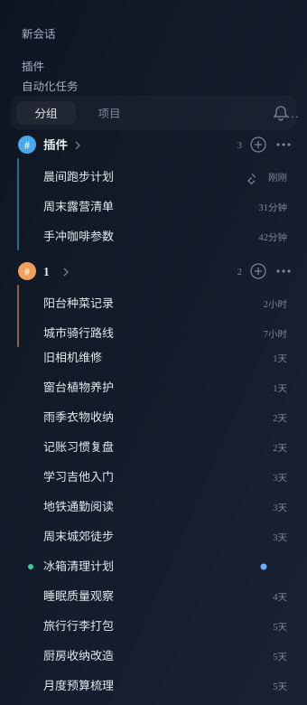
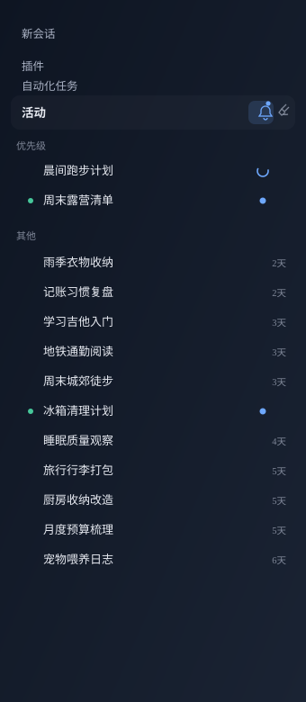

# dsh-task-groups

> [中文](README.md) | English

Custom groups and an activity bell for the DeepSeek Harness sidebar.



## Features

- **Custom groups** — drag a group card anywhere in the list, even between ungrouped tasks. `#` recolors, `⋯` edits / marks all read / archives / deletes, `⊕` starts a task inside the group.
- **Activity bell** — see running, waiting and unread conversations at a glance. Opening an unread one keeps it in the priority list; the **broom** moves read ones to “Others”.
- **Project view** — the native per-workspace list, with its five-row window and “show more”.
- **Drag & drop** — one gesture for tasks and groups: floating card, blue insertion line, auto-scroll. Drop inside a group to join it, outside to leave it.
- **Context menu** — rename, pin, mark unread, branch, copy working directory / session id, move to group, archive.



## Install

```powershell
git clone https://github.com/spike237/dsh-task-groups.git
cd dsh-task-groups
node tools/enable-profile.mjs
```

Installs into the `desktop` profile by default; use `--profile <name>` for another profile and `--home <DSH_HOME>` for a clean environment. Restart DSH afterwards.

Uninstall: `node tools/enable-profile.mjs --remove`

## Usage

| Where | What |
| --- | --- |
| `Groups \| Projects` | switch the grouping mode |
| Bell | activity view; click again to go back |
| Group `#` | color / rename / delete |
| Group `⋯` | edit, mark all read, archive chat (confirmed), new group, delete |
| Group `⊕` | start a task in that group |
| Row hover | pin / archive |
| Row right-click | full menu |
| Drag outside groups | remove from its group |

## Data

`$DSH_HOME/task-groups/state.json`

```json
{
  "version": 1,
  "groups": [{ "id": "g…", "name": "api", "color": "blue", "collapsed": false, "order": 0 }],
  "assignments": { "session-…": "g…" },
  "sessionOrder": ["session-…"],
  "prefs": { "view": "groups", "activity": false }
}
```

Validated and written atomically by the Host; the browser keeps an in-memory copy and PUTs it 350ms after the last change.

## Tests

```powershell
npm test       # jsdom render: groups / drag / projects / activity / menus
npm run smoke  # Host: route registration, state round-trip, validation
```

## License

[MIT](LICENSE)
