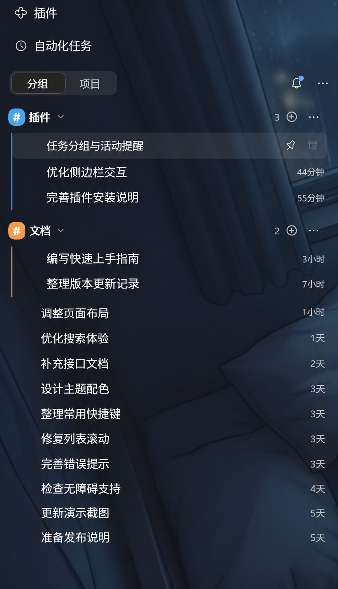
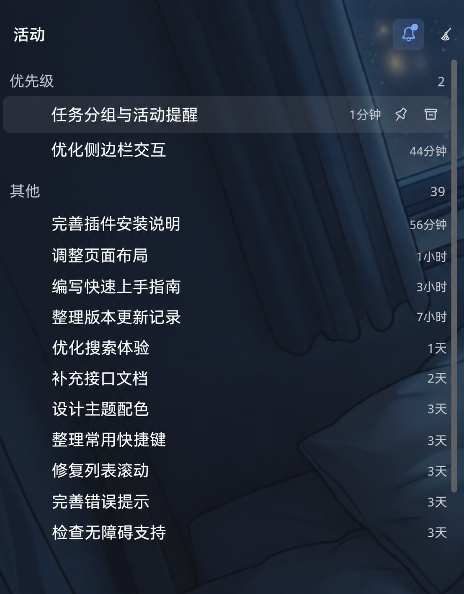
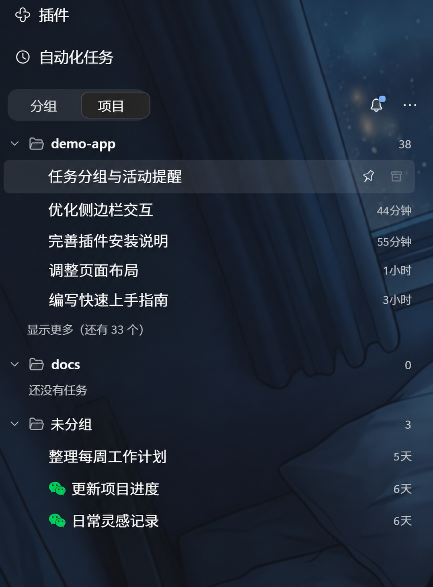

<div align="center">

# 🗂️ DSH Task Groups

**给任务分个组，把正在发生的事放到眼前。**

为 DeepSeek Harness 侧边栏添加自定义任务分组和活动铃铛。

[](package.json)
[](package.json)
[](LICENSE)

**中文** · [English](README.en.md)

[功能预览](#preview) · [快速安装](#install) · [使用指南](#usage) · [反馈问题](https://github.com/spike237/dsh-task-groups/issues)

</div>

<a id="preview"></a>

## ✨ 两个小功能，让侧边栏更好用

任务多了，按自己的习惯整理；同时开着多个会话，点一下铃铛查看进展。

<table>
  <tr>
    <th width="50%">🗂️ 任务分组</th>
    <th width="50%">🔔 活动铃铛</th>
  </tr>
  <tr>
    <td align="center" valign="top">
      <p>按主题归类，自由拖拽排序。</p>
      <a href="docs/images/groups.png"></a>
    </td>
    <td align="center" valign="top">
      <p>集中查看运行中、待确认和未读会话。</p>
      <a href="docs/images/activity.png"></a>
    </td>
  </tr>
</table>

<sub>展示图基于实际界面截图处理，任务与项目名称已替换为演示内容，并调整了文字排版。背景与主题以你的 DSH 设置为准。</sub>

### 🗂️ 按自己的方式整理任务

- **自定义分组**：把相关会话放在一起，为分组命名、换色，随时折叠或展开。
- **拖拽整理**：调整任务和分组的顺序；拖进分组即可归类，拖到组外即可移出。分组也可以放在未分组任务之间。
- **组内操作**：直接新建任务，或批量标为已读、归档会话。
- **保留项目视图**：随时切回按工作区查看，继续使用「显示更多」展开任务列表。

<details>
<summary>📁 查看项目视图</summary>

<p align="center">
  <a href="docs/images/projects.png"></a>
</p>

</details>

### 🔔 一眼找到需要关注的会话

点击侧边栏的小铃铛，打开「活动」面板。**运行中、等待确认和未读的会话**会集中在「优先级」，其余会话列在「其他」。

打开未读会话后，它仍会留在「优先级」，方便来回查看。处理完后，点击右上角的**扫帚（清除已读）**，将可清理的会话移入「其他」；运行中或等待确认的会话会继续保留。再次点击铃铛即可返回任务列表。

<a id="install"></a>

## 🚀 快速安装

需要已安装并运行过的 **DeepSeek Harness**，以及 **Git** 和 **Node.js 20.11+**。以下以 Windows 的默认 `desktop` profile 为例：

```powershell
git clone https://github.com/spike237/dsh-task-groups.git
cd dsh-task-groups
node tools/enable-profile.mjs
```

**重启 DSH**，侧边栏出现「分组 / 项目」切换和小铃铛后即可使用。

> [!NOTE]
> 安装脚本会备份并修改已有的 profile 配置，将插件链接到当前仓库目录。安装后请保留这个目录；如果移动了目录，需要重新设置链接。

<details>
<summary>其他 profile、自定义路径与卸载</summary>

指定已有的 profile：

```powershell
node tools/enable-profile.mjs --profile my-profile
```

指定 DSH 数据目录（其中需已有对应的 `profiles/<name>/package.json`）：

```powershell
node tools/enable-profile.mjs --home "D:\DSH" --profile desktop
```

未传入 `--home` 时，脚本优先使用环境变量 `DSH_HOME`，否则使用 `%USERPROFILE%\.dsh`。

卸载默认 profile 中的插件，然后重启 DSH：

```powershell
node tools/enable-profile.mjs --remove
```

如果安装时指定了 `--home` 或 `--profile`，卸载时使用相同参数。卸载会移除插件配置与目录链接，保留分组数据。

</details>

<a id="usage"></a>

## 🧭 使用指南

从侧边栏右上角的 **`⋯` → 新建分组** 开始，再把相关任务拖进去。

| 想做什么 | 怎么操作 |
| --- | --- |
| 切换整理方式 | 点击顶部「分组 / 项目」 |
| 修改分组名称或颜色 | 点击分组前的彩色 `#` 图标 |
| 在组内新建任务 | 点击分组右侧的 `⊕` |
| 调整顺序或所属分组 | 拖动任务或分组，按插入线放置 |
| 查看当前活动 | 点击小铃铛；再次点击返回 |
| 清理活动列表 | 点击活动面板右上角的扫帚 |
| 搜索任务 | 顶部 `⋯` → 搜索任务 |
| 更多任务操作 | 右键任务，可重命名、置顶、标记未读、分支、移动到分组或归档 |

删除分组只会解除任务的分组关系，任务仍然保留。需要批量归档时，使用分组 `⋯` 菜单中的归档操作。

## 🛠️ 开发与数据

分组、任务归属、排序和视图偏好保存在 `$DSH_HOME/task-groups/state.json`；未设置 `DSH_HOME` 时使用用户目录下的 `.dsh`。由 Host 校验并原子写入，重启后可恢复。

<details>
<summary>运行检查</summary>

Host 状态读写与校验：

```powershell
npm run smoke
```

界面渲染与交互检查需要一个已安装 `react`、`react-dom` 和 `jsdom` 的开发环境。将 `DSH_DEV_CHECKOUT` 指向该环境的 `package.json`：

```powershell
$env:DSH_DEV_CHECKOUT = "D:\path\to\dev-project\package.json"
npm test
```

覆盖分组、拖拽、项目视图、活动面板与菜单交互。

</details>

## 📄 许可

[MIT](LICENSE)
